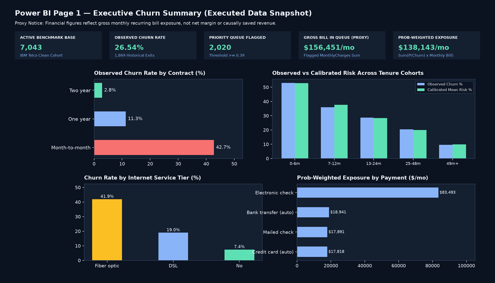
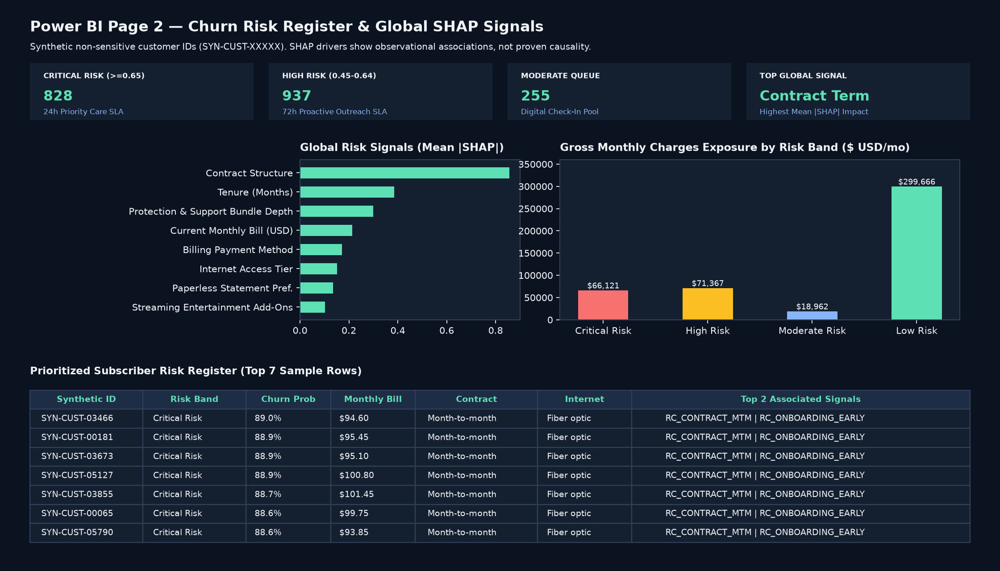
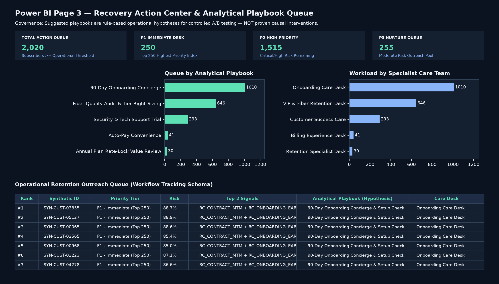
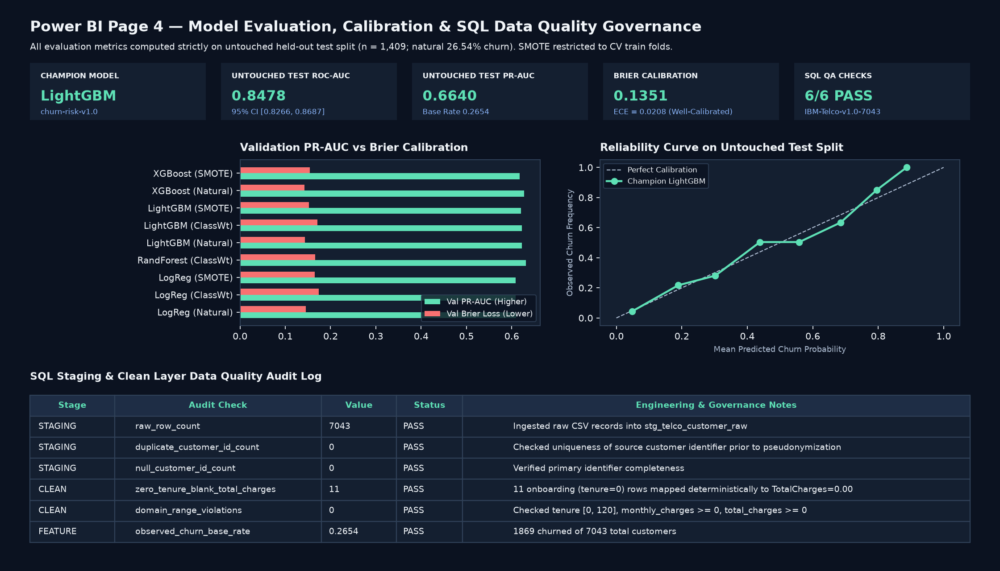

# Customer Churn Intelligence & Retention Action Center

**End-to-End Subscription Churn Intelligence: SQL Server Warehouse (`T-SQL`) → Calibrated LightGBM & TreeSHAP Scoring → Power BI Star Schema & Interactive Retention Action Center**

- **Developer Profile:** [github.com/fotroslab](https://github.com/fotroslab/)
- **Domain:** Business Intelligence · Predictive Analytics · Explainable AI · Retention Operations
- **Primary Stack:** SQL Server (`T-SQL` + local `SQLite` execution mirror) · Python 3.11+ · `scikit-learn` · `LightGBM` · `XGBoost` · `imbalanced-learn` · `SHAP` · Power BI (`DAX`, `Power Query M`, JSON Theme) · `Streamlit`

---

## 1. Overview

Subscription businesses need more than an offline notebook ROC curve—they need an auditable pipeline from raw billing records to a **capacity-aware retention outreach queue** that executives and care specialists can act on.

This portfolio project implements a complete, leakage-free analytical workflow:
1. **SQL Staging, Cleaning & Quality Governance:** Five versioned Microsoft SQL Server (`T-SQL`) scripts (`stg` → `cln` → `feat` → `ml` → `bi`) mirrored locally in SQLite so the full pipeline runs reproducibly anywhere with a single command (`python scripts/run_pipeline.py`).
2. **Honest Predictive Modeling & Calibration Study:** A stratified `60% / 20% / 20%` Train / Validation / Untouched Test split comparing **Logistic Regression**, **Random Forest**, **LightGBM**, and **XGBoost** across **Natural Priors**, **Class Weights**, and **In-Fold SMOTE** (strictly confined inside training CV folds).
3. **Capacity- & Cost-Aware Operational Policy:** Decision cutoff optimized on the Validation split (`0.39` vs default `0.50`) subject to a `30%` care team outreach capacity cap, paired with additive **TreeSHAP** non-causal reason codes and rule-based outreach playbooks.
4. **Power BI Semantic Pack + Browser-Ready Interactive App:** Ships an 8-table **Power BI Star Schema**, **25 documented DAX measures**, **Power Query (M) connectors**, **Dark Executive Theme JSON (`#0B1220`)**, **4-page executed PNG/PDF snapshots**, and a **6-view interactive Streamlit application** so reviewers can test every workflow in a browser without installing Power BI Desktop or SQL Server.

> **Native `.pbix` Transparency Note:** Binary `.pbix` files require Microsoft's proprietary Windows Power BI Desktop (`VertiPaq`) engine to compile. Rather than shipping a renamed or non-native file, this repository provides the complete generated Star Schema CSVs, T-SQL views, DAX Query View script, Power Query connectors, JSON theme, and step-by-step assembly guide (`powerbi/POWER_BI_BUILD_GUIDE_FA.md`), alongside executed 4-page snapshots (`powerbi/snapshots/`).

---

## 2. Business Problem

### Operational Objective
A recurring-revenue telecom provider wants to:
- Understand structural attrition patterns across contract commitments, onboarding cohorts, service tiers, and payment channels.
- Score active subscribers **prior to exit** with calibrated probabilities and human-readable risk signals.
- Route a prioritized outreach queue (`P1 Immediate`, `P2 High Priority`, `P3 Standard`) across specialized care desks (*Onboarding Care*, *VIP & Fiber Retention*, *Customer Success*, *Billing Experience*, *Retention Specialist*).

### Target Users
- **VP of Customer Success / Marketing:** Monitors portfolio churn rate, cohort curves, and gross monthly recurring billing exposure.
- **Retention Operations Lead & Care Specialists:** Works the prioritized Recovery Action Center queue, inspects subscriber-specific risk signals, and logs contact outcomes.
- **BI & Data Science Reviewers:** Audits SQL schema design, Star Schema relationships, DAX measures, calibration fidelity, and leakage controls.

### Financial & Causal Governance Guardrails
- **Exposure Proxy, Not Net Profit:** Financial figures report **Gross Monthly Charges in Queue (`MonthlyCharges` USD/month)** and **Probability-Weighted Monthly Exposure (`P(Churn) × MonthlyCharges`)**. Because cost-of-service and gross margin are unobserved in the public benchmark, figures are explicitly labeled as gross billing proxies.
- **Risk Score ≠ Causal Uplift:** High churn probability does not prove that a phone call or discount will prevent cancellation. Suggested playbooks are **analytical hypotheses** designed to be validated via randomized holdout uplift experiments.

---

## 3. Dataset

| Attribute | Verified Value |
|---|---|
| **Dataset Name** | IBM Telco Customer Churn Sample Dataset (`WA_Fn-UseC_-Telco-Customer-Churn.csv`) |
| **Official Upstream Source** | [`IBM/telco-customer-churn-on-icp4d`](https://github.com/IBM/telco-customer-churn-on-icp4d) (`data/Telco-Customer-Churn.csv`) |
| **SHA-256 Checksum** | `16320c9c1ec72448db59aa0a26a0b95401046bef5d02fd3aeb906448e3055e91` |
| **Upstream License** | Repository licensed under **Apache License 2.0** (sample benchmark dataset; not real personal subscriber data) |
| **Dimensions** | **7,043 subscribers** × **21 columns** (`0` duplicate keys) |
| **Target (`Churn`)** | `Yes`: **1,869** (`26.54%`) · `No`: **5,174** (`73.46%`) |
| **Documented Data Quirk** | Exactly **11 rows** contain whitespace `" "` in `TotalCharges`; all 11 have `tenure = 0` (first-month onboarding subscribers prior to first statement) and are deterministically mapped to `TotalCharges = 0.00` in SQL (`was_total_charges_zero_imputed = 1`). |
| **Privacy & Pseudonymization** | Source identifiers are stripped from downstream tables and replaced with deterministic non-sensitive keys (`SYN-CUST-00001` … `SYN-CUST-07043`). |

---

## 4. Methodology

### 4.1 SQL Warehouse & Leakage-Free Feature Engineering
The SQL pipeline (`sql/01_*.sql` through `sql/05_*.sql`) enforces `CHECK` constraints, data-type casting, audit logging (`stg.pipeline_audit_log`), and strictly **row-local observable features** (`feat.vw_customer_churn_features`):
- Lifecycle stage (`tenure_cohort`: `0-6m Onboarding`, `7-12m Early`, `13-24m Developing`, `25-48m Established`, `49m+ Loyal`).
- Service stickiness depth (`active_addon_count`, `protection_support_count` across Online Security, Backup, Device Protection, Tech Support).
- Billing friction flags (`is_month_to_month`, `is_fiber_optic`, `is_electronic_check`, `has_auto_pay`) and historical spend comparison (`avg_historical_monthly_spend`, `charge_velocity_delta`).
- **Zero Cross-Row Leakage:** No population statistics (medians, means, standard deviations, one-hot vocabularies, or SMOTE synthetic points) are computed in SQL; all statistical transformers are fitted strictly inside `scikit-learn` / `imbalanced-learn` training splits.

### 4.2 Stratified Split & Imbalance Ablation Protocol
- **Split Before Any Processing (`random_state = 42`):**
  - `Train`: **4,225** rows (`60%`, `26.53%` churn) — 5-fold Stratified Cross-Validation.
  - `Validation`: **1,409** rows (`20%`, untouched `26.54%` churn) — model selection, calibration verification, and threshold optimization.
  - `Held-Out Test`: **1,409** rows (`20%`, untouched `26.54%` churn) — evaluated once with 500-iteration bootstrap 95% confidence intervals.
- **SMOTE Isolation:** `SMOTE(sampling_strategy=0.85)` is wrapped inside `imblearn.pipeline.Pipeline` so synthetic samples are generated **only inside each training fold** and never touch validation or test data.

### 4.3 Operational Threshold Selection & Additive TreeSHAP
- Rather than relying on an arbitrary `0.50` threshold, `optimize_operational_threshold()` evaluates candidate cutoffs on the **Validation** set under a `30%` maximum outreach capacity constraint and transparent planning cost assumptions (`$8` outreach cost vs `$65` missed-churn scenario penalty), selecting **`0.39`**.
- **OHE-Additive TreeSHAP:** One-hot encoded SHAP values are summed back to their exact parent business concepts via Shapley additivity, producing top-3 non-causal reason codes (`RC_CONTRACT_MTM`, `RC_ONBOARDING_EARLY`, `RC_FIBER_EXPOSURE`, `RC_NO_SUPPORT_SHIELD`, `RC_MANUAL_ECHECK`) and routing queued accounts across 5 care playbooks.

---

## 5. Key Features

- **4-Page Power BI Semantic Architecture** (`Churn Summary`, `Churn Risk Register`, `Recovery Action Center`, `Model & Data Quality`) backed by a clean Star Schema (`dim_customer`, `dim_contract_billing`, `dim_service_bundle`, `dim_risk_band` → `fact_customer_churn_scoring`).
- **6-View Interactive Web Application (`streamlit_app.py`)** adhering to the `#0B1220 / #141F30 / #5EE0B5 / #8AB4F8` executive dark design system, including optional bilingual Persian guidance (`FA Guide`).
- **Interactive Capacity & Cost Policy Planner** + **Care Specialist Outreach Logger** persisting follow-up status and call outcomes directly to the warehouse.
- **Live Subscriber Scoring & What-If Sensitivity Demo** with 4 one-click sample profiles, strict input validation, and customer-level TreeSHAP explanations.
- **Operational Exports:** Filtered CSV registers, multi-sheet Excel (`.xlsx`) operations packs, and 1-page Executive PDF briefs.

---

## 6. Evaluation / Results (Executed on Real Data)

### 6.1 Champion Performance on Untouched Held-Out Test Set (`n = 1,409`, Natural Churn `26.54%`)

Selected Champion: **`LightGBM | Natural Prior (Regularized)`** (`churn-risk-v1.0`)

| Metric | Default Cutoff (`0.50`) | Operational Cutoff (`0.39`) | 95% Bootstrap CI (`@ 0.39`) |
|---|---|---|---|
| **ROC-AUC** | `0.8478` | **`0.8478`** | `[0.8266, 0.8687]` |
| **PR-AUC** (Random baseline = `0.2654`) | `0.6640` | **`0.6640`** | `[0.6131, 0.7104]` |
| **Brier Calibration Score** (Lower is better) | `0.1351` | **`0.1351`** | `[0.1238, 0.1443]` |
| **Expected Calibration Error (ECE)** | `0.0208` | **`0.0208`** | Mean Pred `0.2661` vs Actual `0.2654` |
| **Recall (Actual Churners Captured)** | `51.87%` (`194 / 374`) | **`66.84%`** (`250 / 374`) | `[61.39%, 71.84%]` |
| **Precision (Hit Rate in Queue)** | `63.19%` (`194 / 307`) | **`60.24%`** (`250 / 415`) | `[55.02%, 64.63%]` |
| **Natural-Test F1-Score** | `0.5698` | **`0.6337`** | `[0.5897, 0.6726]` |
| **Outreach Queue Rate (% of Base)** | `21.79%` | **`29.45%`** | Within `<= 30%` Team Capacity Cap |

### 6.2 Empirical Finding: Why Natural Calibration + Threshold Optimization Beats SMOTE Here

| Candidate Pipeline | 5-Fold CV ROC-AUC | Val PR-AUC | Val Brier Loss | Val ECE | Val Mean `P(Churn)` |
|---|---|---|---|---|---|
| **LightGBM \| Natural Prior (Selected)** | `0.8528 ± 0.0216` | `0.6226` | **`0.1436`** | **`0.0230`** | **`0.2692`** *(True: `0.2654`)* |
| XGBoost \| Natural Prior | `0.8537 ± 0.0198` | `0.6274` | `0.1425` | `0.0180` | `0.2689` |
| Logistic Regression \| Natural Baseline | `0.8559 ± 0.0187` | `0.6100` | `0.1449` | `0.0315` | `0.2671` |
| Random Forest \| Class-Weighted Subsample | `0.8531 ± 0.0181` | `0.6309` | `0.1660` | `0.1333` | `0.3988` *(Inflated)* |
| LightGBM \| In-Fold SMOTE | `0.8517 ± 0.0208` | `0.6207` | `0.1519` | `0.0686` | `0.3306` *(Inflated)* |
| LightGBM \| Class-Weighted | `0.8509 ± 0.0215` | `0.6224` | `0.1710` | `0.1425` | `0.4079` *(Inflated)* |
| Logistic Regression \| In-Fold SMOTE | `0.8546 ± 0.0194` | `0.6088` | `0.1653` | `0.1109` | `0.3756` *(Inflated)* |

**Key Takeaway:** Applying `SMOTE` or `class_weight='balanced'` did not improve ranking power (`ROC-AUC` / `PR-AUC`), while inflating average predicted probabilities from `~26.6%` to `33%–41%` (`ECE` up to `0.1425`). That miscalibration would severely overstate `P(Churn) × MonthlyCharges` financial exposure in Power BI. Keeping well-calibrated natural probabilities (`Test ECE = 0.0208`) and shifting the operational cutoff to `0.39` increases recall by **+14.97 percentage points** without corrupting probability calibration.

### 6.3 Executed Portfolio Exposure Summary (IBM Benchmark Cohort, `N = 7,043`)
- **Total Monthly Recurring Billing:** `$456,116.60 / month`
- **Flagged Retention Action Queue (`p >= 0.39`):** `2,020` subscribers (`250 P1 Immediate`, `1,515 P2 High`, `255 P3 Nurture`)
- **Gross Monthly Charges in Flagged Queue (Proxy):** `$156,450.75 / month` (`$31,538.70 / month` in untouched test split)
- **Probability-Weighted Monthly Exposure (Proxy):** `$138,142.62 / month`

### 6.4 Power BI Reference Page Snapshots (Generated from Executed Pipeline)

| Page 1 — Executive Churn Summary | Page 2 — Churn Risk Register |
|---|---|
|  |  |

| Page 3 — Recovery Action Center | Page 4 — Model & Data Quality |
|---|---|
|  |  |

---

## 7. Limitations

1. **Static Educational Benchmark:** IBM Telco (`7,043` rows) lacks longitudinal event timestamps, usage decline trends, support call transcripts, and competitor promo data. Real production churn models require temporal backtesting (out-of-time splits) rather than cross-sectional splits.
2. **Untouched Natural F1 vs Oversampled F1:** An `F1` of `0.6337` on a natural `26.54%` positive test set cannot be compared directly against `F1 ≈ 0.90` numbers reported on `50% / 50%` SMOTE-balanced test sets (where random precision is artificially doubled).
3. **Observational SHAP ≠ Causal Intervention Lift:** `RC_CONTRACT_MTM` or `RC_ONBOARDING_EARLY` identify *who* is at risk and *what attributes correlate with risk*, not *whether* an outreach call will reduce churn. Some contacted subscribers may exhibit "sleeping dog" sensitization if pitched aggressively.
4. **Gross Billing vs Net Margin:** `MonthlyCharges` is gross billed price, not net contribution margin or Customer Lifetime Value (CLV).
5. **Power BI Native File Compilation:** Final `.pbix` compilation requires opening the generated `data/powerbi_mart/` tables (or SQL Server `ChurnIntelligenceDB`) inside Windows Power BI Desktop per `powerbi/POWER_BI_BUILD_GUIDE_FA.md`.

---

## 8. Local Setup

```bash
# 1. Clone repository and enter directory
git clone https://github.com/fotroslab/customer-churn-intelligence-action-center.git
cd customer-churn-intelligence-action-center

# 2. Create virtual environment and install pinned dependencies
python -m venv .venv
# Windows: .venv\Scripts\activate   |   macOS/Linux: source .venv/bin/activate
pip install -r requirements.txt

# 3. Run full reproducible pipeline (CSV -> SQLite Warehouse -> ML/SHAP -> Power BI Mart & Snapshots)
python scripts/run_pipeline.py

# 4. Run automated validation & UI test suite (18 tests)
pytest -v

# 5. Launch interactive web application locally
streamlit run streamlit_app.py
```

---

## 9. Deployment

See **[`DEPLOYMENT.md`](DEPLOYMENT.md)** for full step-by-step browser-only instructions (no local Git or VS Code required):
- **Interactive Web Demo (Free, Public Link, Zero Viewer Login):** Deploy `streamlit_app.py` on **Streamlit Community Cloud** directly from your public GitHub repository.
- **Power BI Desktop & Service Sharing:** Build `Customer_Churn_Intelligence_Action_Center.pbix` using `powerbi/POWER_BI_BUILD_GUIDE_FA.md`. Note that Power BI `Publish to web` requires a Microsoft Fabric work/school tenant with admin enablement and exposes underlying report data publicly on the internet—use **only** with public/synthetic portfolio datasets, never confidential customer records.

---

## 10. Project Structure

```text
customer-churn-intelligence-action-center/
├── streamlit_app.py                  # 6-view interactive BI & Retention Action Center web app
├── requirements.txt                  # Reproducible Python package versions
├── runtime.txt                       # Cloud Python version (python-3.11)
├── pytest.ini                        # Test runner configuration
├── LICENSE                           # MIT License
├── README.md                         # Project documentation (English)
├── DEPLOYMENT.md                     # Browser-first cloud & Power BI deployment guide
├── .streamlit/config.toml            # Dark executive visual theme (#0B1220)
├── config/project_config.json        # Version metadata, policy parameters & author profile
├── data/
│   ├── raw/                          # Verified IBM Telco Customer Churn CSV
│   ├── warehouse/                    # Reproducible SQLite mirror (churn_intelligence.db)
│   └── powerbi_mart/                 # 8 Star Schema CSV tables ready for Power BI Desktop
├── models/                           # Serialized LightGBM bundle, metrics JSON, SHAP & calibration CSVs
├── powerbi/
│   ├── theme/                        # ChurnIntelligenceDarkTheme.json for Power BI Desktop
│   ├── dax/                          # measures_library.dax (25 documented DAX measures)
│   ├── powerquery/                   # SQL Server & CSV Mart Power Query (M) connectors
│   ├── snapshots/                    # Executed 4-page PNG snapshots + compiled PDF preview
│   ├── MODEL_SCHEMA_DIAGRAM.svg      # Star Schema entity-relationship diagram
│   └── POWER_BI_BUILD_GUIDE_FA.md    # Step-by-step Power BI Desktop assembly & refresh guide
├── sql/                              # 5 production Microsoft SQL Server (T-SQL) scripts
├── scripts/run_pipeline.py           # End-to-end orchestrator
├── src/                              # Modular ingestion, features, modeling, SHAP, snapshots & exports
└── tests/                            # 18 pytest unit, leakage, SMOTE, validation & UI tests
```

---

## Acknowledgements & Third-Party Reference Notes

- **Dataset:** IBM Sample Data Sets — [`IBM/telco-customer-churn-on-icp4d`](https://github.com/IBM/telco-customer-churn-on-icp4d) (Apache-2.0 repository license).
- **Workflow Inspiration (No Code, Text, or Visuals Copied):**
  - [`shyamal-bhatt/Customer-Churn-Prediction-Retention-Strategy-Using-SQL-Power-BI-Machine-Learning`](https://github.com/shyamal-bhatt/Customer-Churn-Prediction-Retention-Strategy-Using-SQL-Power-BI-Machine-Learning) — studied for high-level SQL → ML → Power BI workflow framing. *Evaluation protocol note:* that repository reports `F1 ≈ 0.90` on balanced data; our project evaluates strictly on an untouched natural test split (`26.54%` churn), yielding `F1 = 0.6337` (`ROC-AUC = 0.8478`).
  - [`Hizafa-Nadeem/TelecomChurnPrediction`](https://github.com/Hizafa-Nadeem/TelecomChurnPrediction) — studied for honest evaluation, probability calibration, cost-based thresholding, and SHAP reason framing.
  - External community dashboard concepts referenced under *"Customer Churn Intelligence Platform Power BI"* (e.g., third-party claims of `AUC = 0.923` or `$886K` exposure) are treated strictly as unverified third-party claims on separate datasets/definitions and are **not** used in this project.
